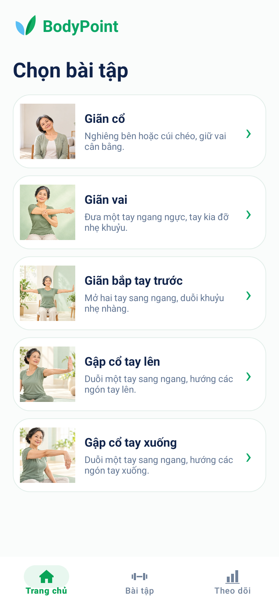
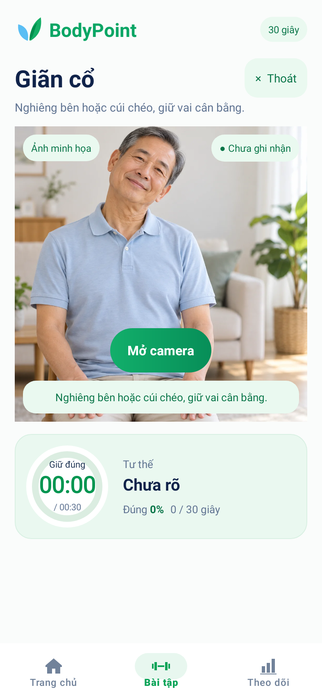
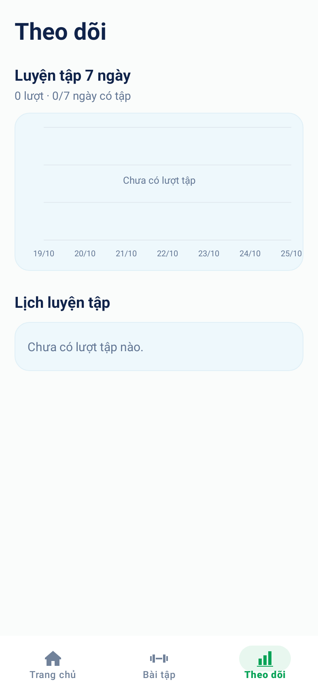
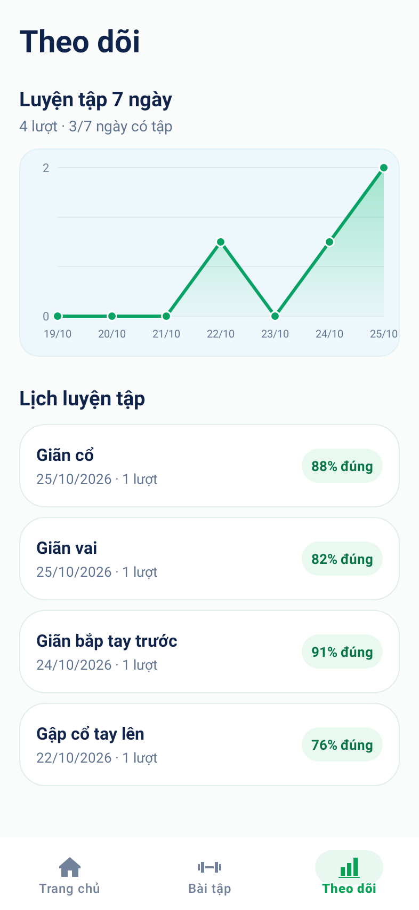

# Ảnh xem trước giao diện Android

Các ảnh này được render từ layout Android thực của ứng dụng ở kích thước màn hình 393 × 852 dp bằng Robolectric, không phải ảnh chụp trên LDPlayer 14. Màn Bài tập đang hiện ảnh minh họa trước khi bật camera. Ảnh Theo dõi có dữ liệu dùng các lượt tập mẫu trong test để cho thấy cách hiển thị lịch tập và tỷ lệ đúng.

## Trang chủ

## Bài tập

## Theo dõi

Để render lại ảnh sau khi sửa layout, chạy `./gradlew :app:testDebugUnitTest --tests vn.edu.mku.ecoscan.ui.UiScreenshotTest` trong môi trường Android SDK đã cấu hình. Ảnh mới nằm ở `app/build/ui-previews/`; chỉ sao chép sang thư mục này khi đã kiểm tra và muốn cập nhật ảnh trên GitHub.
